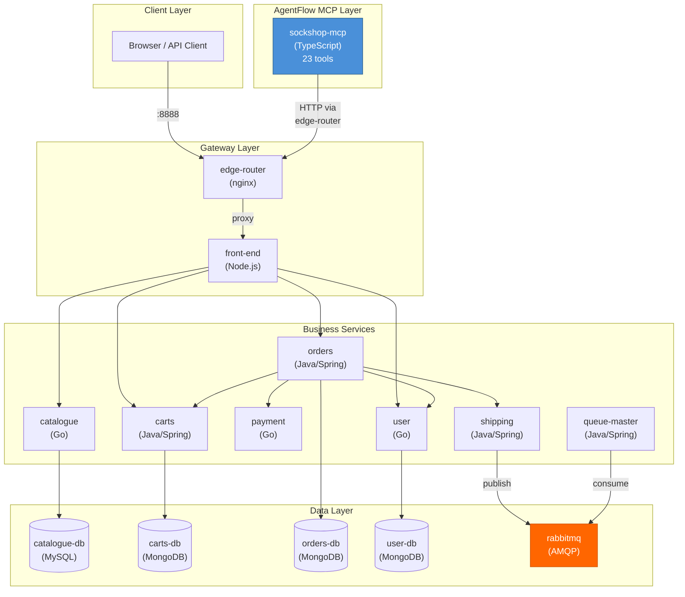

# Sock Shop Service Topology

## Architecture Overview

## Service Summary

| Service | Language | Port | Database | Purpose |
|---------|----------|------|----------|---------|
| edge-router | nginx | 8888 (external) | - | Reverse proxy / gateway |
| front-end | Node.js | 8079 | Redis (optional) | UI + API gateway |
| catalogue | Go | 80 | MySQL | Product browsing |
| carts | Java/Spring | 80 | MongoDB | Shopping cart |
| orders | Java/Spring | 80 | MongoDB | Order processing |
| payment | Go | 80 | - | Payment authorization |
| shipping | Java/Spring | 80 | - | Shipment creation |
| queue-master | Java/Spring | 80 | - | Async shipping processing |
| user | Go | 80 | MongoDB | Authentication & user data |
| sockshop-mcp | TypeScript | 3000 | - | MCP tool server (23 tools) |

## Key Data Flows

### Order Placement (Critical Path)
Touches 6 services in sequence: front-end -> orders -> (user + carts + payment + shipping) -> rabbitmq -> queue-master

### The $100 Payment Threshold
The payment service rejects any order with a total > $100. Combined with the flat $4.99 shipping cost, this makes the "Holy" sock ($99.99) mathematically impossible to purchase.

## Network Architecture
- All services communicate over a Docker bridge network
- No inter-service authentication (any service can call any other)
- No TLS between services
- No circuit breakers or retries
- 5-second timeout on all inter-service HTTP calls
