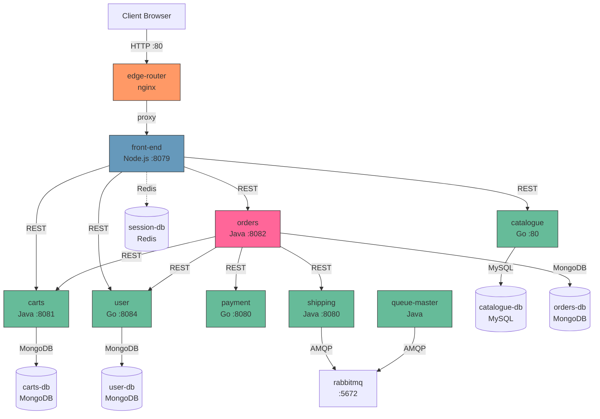

# Sock Shop — Cross-Service Dependency Map

> Synthesised from per-service analysis profiles. Generated 2026-03-16.

---

## Service Dependency Matrix

| Caller | Callee | Protocol | Endpoint | Purpose |
|--------|--------|----------|----------|---------|
| edge-router | front-end | HTTP (nginx proxy) | `/*` | Reverse-proxy all user traffic |
| front-end | catalogue | HTTP/REST | `GET http://catalogue/catalogue`, `/catalogue/size`, `/tags`, `/catalogue/images/*` | Product browsing, search, images |
| front-end | carts | HTTP/REST | `GET/POST/PATCH/DELETE http://carts/carts/{custId}/items`, `GET/DELETE http://carts/carts/{custId}`, `GET /carts/{custId}/merge` | Cart CRUD, anonymous→customer cart merge |
| front-end | orders | HTTP/REST | `POST http://orders/orders`, `GET http://orders/orders/search/customerId` | Place orders, list order history |
| front-end | user | HTTP/REST | `GET http://user/login`, `POST http://user/register`, `GET/POST/DELETE http://user/customers`, `/addresses`, `/cards` | Authentication, user/address/card management |
| front-end | session-db | TCP (Redis) | Redis protocol | Session storage (optional, in-memory fallback) |
| orders | user | HTTP/REST | `GET {caller-supplied URI}` (e.g. `http://user/customers/{id}`) | Fetch customer, address, card for order |
| orders | carts | HTTP/REST | `GET {caller-supplied URI}` (e.g. `http://carts/{id}/items`) | Fetch cart items for order |
| orders | payment | HTTP/REST | `POST http://payment/paymentAuth` | Authorise payment |
| orders | shipping | HTTP/REST | `POST http://shipping/shipping` | Create shipment record |
| shipping | rabbitmq | AMQP | Exchange: default, Routing key: `shipping-task` | Publish shipping task messages |
| queue-master | rabbitmq | AMQP | Queue: `shipping-task` | Consume and process shipping tasks |
| catalogue | catalogue-db | TCP (MySQL) | `catalogue_user:default_password@tcp(catalogue-db:3306)/socksdb` | Product and tag data |
| carts | carts-db | TCP (MongoDB) | `mongodb://carts-db:27017/data` | Cart persistence |
| orders | orders-db | TCP (MongoDB) | `mongodb://orders-db:27017/data` | Order persistence |
| user | user-db | TCP (MongoDB) | `mongodb://user-db:27017/users` (collections: customers, addresses, cards) | User/address/card persistence |

---

## Critical Path: Order Placement

This is the most complex flow, touching 6 services:

```
1. Client ──POST /orders──► front-end (gateway)
   │
   │  Gateway resolves customer, address, card from user service
   │  Assembles URIs for customer, address, card, items
   │
2. front-end ──POST /orders──► orders service
   │
   │  Orders service fetches data in PARALLEL (4 async calls):
   │
3. ├── GET {customer URI} ──► user service        (~5s timeout)
4. ├── GET {address URI}  ──► user service         (~5s timeout)
5. ├── GET {card URI}     ──► user service         (~5s timeout)
6. └── GET {items URI}    ──► carts service        (~5s timeout)
   │
   │  Wait for all 4 futures, calculate total (sum + $4.99 shipping)
   │
7. orders ──POST /paymentAuth──► payment service   (~5s timeout)
   │  { amount: total }
   │  Returns: { authorised: true/false, message: "..." }
   │  If declined → 406 PaymentDeclinedException
   │
8. orders ──POST /shipping──► shipping service     (~5s timeout)
   │  { id: UUID, name: customerId }
   │
9. shipping ──AMQP publish──► rabbitmq
   │  Queue: shipping-task, Payload: Shipment JSON
   │
10. orders ──save()──► orders-db (MongoDB)
    │  Embeds full snapshots of customer, address, card, items, shipment
    │
11. queue-master ──AMQP consume──► rabbitmq
    │  Processes shipping task (currently: log to stdout)
```

**Latency profile:** Steps 3-6 run in parallel (~5s worst case). Steps 7-10 are sequential. Theoretical max: ~25s (5 timeouts × 5s each). Typical: <1s if all services are healthy.

**Failure modes:**
- Any of steps 3-6 timeout → `IllegalStateException` (500)
- Step 7 declines → `PaymentDeclinedException` (406)
- Step 8 fails → shipping service swallows exception, returns 201 anyway → **silent data loss**
- Step 9 RabbitMQ down → message silently dropped
- Step 10 MongoDB down → order not persisted

---

## Database Ownership

| Service | Database | Type | Connection | Data Stored |
|---------|----------|------|------------|-------------|
| catalogue | catalogue-db | MySQL 5 | `socksdb` — user: `catalogue_user`, password: `default_password` | Socks (products), Tags, Sock-Tag associations. 10 socks, 11 tags seeded. |
| carts | carts-db | MongoDB 3.4 | `mongodb://carts-db:27017/data` | Cart documents with `@DBRef` Item references |
| orders | orders-db | MongoDB 3.4 | `mongodb://orders-db:27017/data` | CustomerOrder documents (embedded snapshots of customer, address, card, items, shipment) |
| user | user-db | MongoDB (custom image) | `mongodb://user-db:27017/users` | Customers (with SHA-1 hashed passwords), Addresses, Cards (plaintext card numbers) |
| front-end | session-db | Redis | `session-db` hostname | Express sessions (customerId, session ID). Optional — falls back to in-memory. |

**No database sharing** — each service owns its data store exclusively. Cross-service data access is always via REST APIs.

---

## Async Messaging (RabbitMQ)

| Component | Configuration |
|-----------|--------------|
| **Broker** | `rabbitmq:3.6.8` at hostname `rabbitmq`, port 5672, credentials `guest/guest` |
| **Exchange** | `shipping-task-exchange` (TopicExchange) — declared but not actually used for publishing |
| **Queue** | `shipping-task` — **non-durable** (messages lost on broker restart) |
| **Publisher** | Shipping service — `rabbitTemplate.convertAndSend("shipping-task", shipment)` — sends to default exchange with routing key |
| **Consumer** | Queue Master — `SimpleMessageListenerContainer`, single thread, auto-ack |
| **Serialization** | Jackson2 JSON — `Shipment { id: String, name: String }` |
| **Dead Letter** | None configured |
| **Error Handling** | Publisher: swallows exceptions silently. Consumer: exceptions cause infinite requeue. |

**Message flow:** `POST /shipping` → Shipping service → RabbitMQ → Queue Master → `ShippingTaskHandler.handleMessage()` → log to stdout (processing logic is stubbed out).

---

## Mermaid Dependency Diagram



---

## Data Flow: Key Operations

### Browse Products
```
Client → edge-router → front-end → catalogue → catalogue-db (MySQL)
```
Simple GET proxy. No data transformation.

### Add to Cart
```
Client → front-end → catalogue (GET item for unitPrice)
                    → carts (POST item with enriched price)
```
Front-end aggregates: fetches price from catalogue, enriches the cart item before posting.

### Login
```
Client → front-end → user (GET /login with Basic Auth)
                    → carts (GET /merge — merges anonymous cart into customer cart)
```
Session established, anonymous cart merged.

### Place Order
```
Client → front-end → user (GET customer, address, card links)
       → orders → user (GET customer, address, card data)
                → carts (GET items)
                → payment (POST /paymentAuth)
                → shipping (POST /shipping)
                → orders-db (save order with embedded snapshots)
       shipping → rabbitmq → queue-master (async processing)
```
Most complex flow — touches all services except catalogue.
